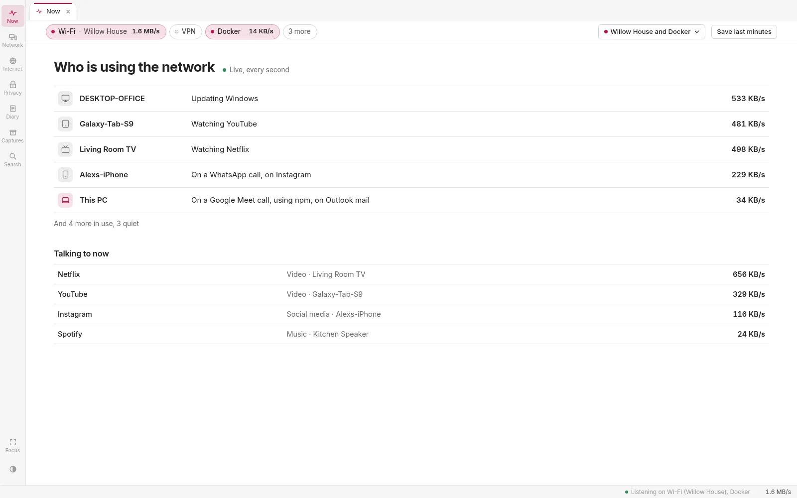
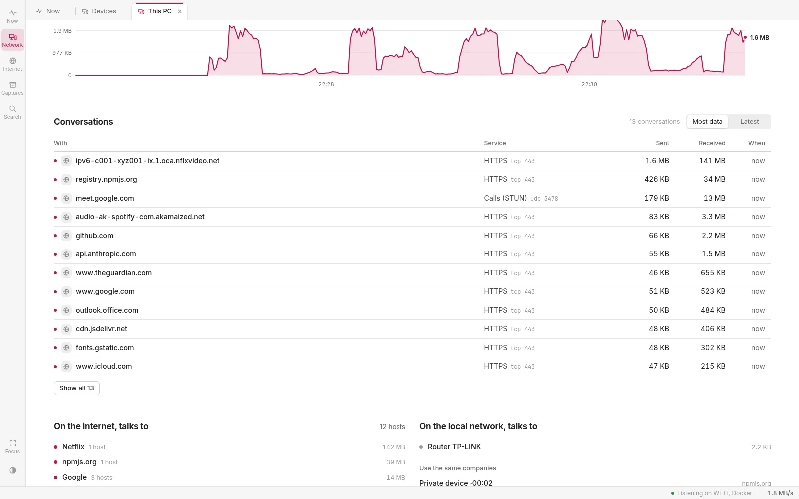
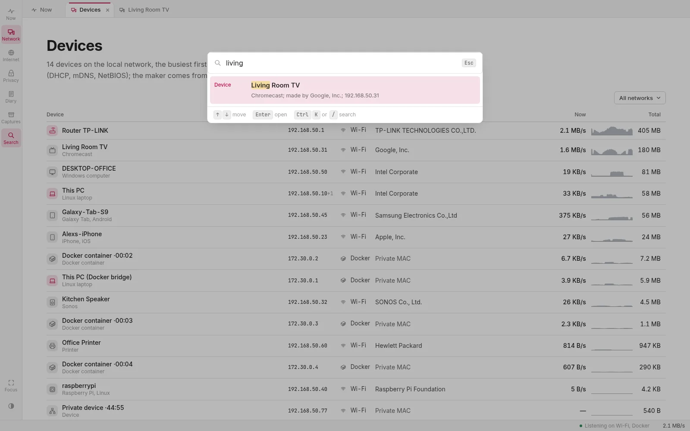

<p align="center">
  <picture>
    <source media="(prefers-color-scheme: dark)" srcset="docs/images/banner-dark.svg">
    
  </picture>
</p>

<p align="center">
  <a href="#what-it-shows">What it shows</a> ·
  <a href="#what-it-cannot-see">What it cannot see</a> ·
  <a href="#quick-start">Quick start</a> ·
  <a href="#how-it-works">How it works</a>
</p>

<p align="center">
  
  
  
  
  
</p>

---

**Argus shows your network as it happens, in plain words.** Open it and it reads like a system monitor: who is using
the network now and for what, a line each ("Living Room TV · Watching Netflix · 2.1 MB/s"), and whom they are talking
to now, moving every second. One click opens a device: what it is doing and with whom, live, then the rest. The day,
its diary and privacy are a click away. It runs on your own machine and listens only; on disk it keeps the last minutes of packets and the day's
totals (never packets). An agent can ask it the same over MCP, the day before included.

<p align="center">
  <picture><source media="(prefers-color-scheme: dark)" srcset="docs/images/now-dark.webp"></picture>
</p>

<p align="center"><sub>Every picture here is of <code>pnpm demo</code>: a made-up house, no real traffic.</sub></p>

## What it shows

**Now, at a glance.** Who is using the network and for what: a line per busy device, in a verb, with how fast over
the last ten seconds, busiest first (five lines, the rest in one); then whom they are talking to now (the app or company, what for, how fast). Both follow the network
every second without a reload; the order holds still while the pointer is over it. When nothing is
listening, it says so rather than show what was. The day by hour, the diary of
episodes ("22:14 the TV started Netflix, 2.3 GB in an hour") and privacy each have their own page. Why it is laid out
that way, and what was turned down: [docs/apresentacao.md](docs/apresentacao.md).

**What each device is**, from what it says of itself: the DHCP vendor class and the options it asks for, the services
and model it announces over mDNS, a User-Agent sent in the clear, its maker, what it talks to. Said with how sure
(*sure*, *likely*, *possibly*) and the clues on its page; when the clues disagree or say nothing, nothing is made up.

**Without encryption, as a small open padlock.** HTTP, FTP, Telnet, mail without TLS, and whether a password went by in it
(the pages, the history and the agent keep only that one did, never the password; the ring buffer of the last minutes,
and a capture you save from it, hold the packets as they were, the password too): a small open padlock beside the line, with what it was in its tip,
in every list and on each device; the full account on the Privacy page. Connectivity checks and certificate lists, in the clear by design,
are said quietly. Also: tracking and telemetry by company and device, servers that agree old TLS, devices that ask
another DNS than the house's (or encrypted DNS), and where the data goes (the country each host's network is
registered in, from iptoasn.com's table: `pnpm geo` downloads it once). No alerts, no notifications.

**The day, kept.** A minute at a time, per device and per what it was for, never packets: 31 days and 200 MB at
most, gzipped once the day is over. A reload or a restart loses nothing.

**Devices**, each named the way it named itself: the hostname a phone gives when it asks for an address (DHCP), what a
TV or a speaker announces on the local network (mDNS), a Windows PC's name (NetBIOS). The maker comes from the first
half of the MAC address; a phone that makes up a MAC for each network is said to, rather than guessed at. The router and
this PC are known by what they do.

**The internet, by company.** Hosts are named by the DNS answers your network got for them and by the server name an
encrypted connection asks for in the clear (SNI), then grouped by who runs them: `rr3---sn-…googlevideo.com` is Google.

**Networks.** Where it listens is a bar of pills at the top of every page: each interface a switch, with the network
it is on now (its Wi-Fi's name) and its rate; the minor ones (Docker's bridges, what is down) behind "more". Each
network you were on is kept apart: home, the office and a café are three networks, though all three may hand
out the same addresses on the same Wi-Fi card, and home by cable and by Wi-Fi is one. A network is its router (the way out your
PC's frames go through), named by its Wi-Fi when there is one. The bar says the two apart: *Listen on* (the pills) and
*Showing* (the menu beside them): the network of now by default, an earlier one, or all of them together, and the
devices, the hosts, the diary and the agent's answers follow. In one network's list a device that was also on others
says "+1 elsewhere"; one heard far from any stay is on no network rather than guessed into one. A day kept before Argus told networks apart says so, rather than being split after the fact.

**Conversations.** Open a device, a host, a company or a network and it says whom it talked to, by what service (as
the port says: HTTPS, DNS, QUIC…), how much each way and when, live; the other end is a click away.

**What it was for.** A dictionary reads each conversation's names, address and port, and what the traffic looks like,
into the company, the app and what someone is doing: `rr3---sn-…googlevideo.com` is Google · YouTube · watching video;
WhatsApp over STUN is a call; a WireGuard tunnel on port 443 is a VPN, not the web. A CDN says who carries the bytes,
never whose app they are. Built on open lists (v2fly's, the Public Suffix List, iptoasn); which, why, and how much of
a real house it says: [docs/dicionario.md](docs/dicionario.md).

**Live.** A bandwidth chart for the whole network and for each device, a second at a time for the last ten minutes, a
minute at a time for the day. Rows hold still while you read them, and a device that just turned up is marked.

<p align="center">
  <picture><source media="(prefers-color-scheme: dark)" srcset="docs/images/device-dark.webp"></picture>
  <picture><source media="(prefers-color-scheme: dark)" srcset="docs/images/search-dark.webp"></picture>
</p>

Everything links to everything: a device to the companies it uses, a company to its hosts and the devices that use it,
an interface to what was heard on it. Search finds any of them (Ctrl+K), hovering a name shows its card, and a
right-click copies its address or MAC.

**Captures.** The last minutes of each interface stay on disk in a bounded ring buffer. Save them, and they become a
capture you can open again as it was, or in Wireshark.

## What it cannot see

Argus listens: no monitor mode, nobody's traffic changed. What is encrypted is not read; you see who talks to whom,
when and how much. And on an ordinary home network (a router, a switch), a PC hears mostly its own traffic and what the
others announce to everyone, not what they say to each other or to the internet. The page says so too, once.

To find the devices it cannot hear, it reads this PC's neighbour table and any DHCP lease file on it (local reads,
nothing sent), and, only when you press *Scan … now* on Devices, scans the LAN with `nmap -sn`: the one thing Argus
sends (an ARP request and a TCP connection attempt to ports 80 and 443 per address of the /24, then a DNS question for
the names of those that answered). They are listed apart, as found and not heard: no traffic of theirs is known.
[docs/sources.md](docs/sources.md) has the rule.

## Quick start

**You need** Linux, [Node.js](https://nodejs.org) 24.2 or newer, [pnpm](https://pnpm.io), and Wireshark's command-line
tools (`tshark`, `dumpcap`, `mergecap`).

```sh
git clone https://github.com/Di0go/argus.git
cd argus
pnpm install
pnpm demo           # a made-up house, nothing captured: http://localhost:4950
```

To listen for real, this user needs to be allowed to capture. Only `dumpcap` gets that right (Wireshark's capture
capabilities); Argus itself never runs as root. On Arch, once:

```sh
pkexec bash "$PWD/scripts/install-capture.sh"   # wireshark-cli, the wireshark group, argus.test (read it first)
pnpm start                                        # builds the interface and starts the server on :4930
```

Then turn an interface on at **http://localhost:4930** (or **https://argus.test**). What was on is listened on again
after a restart.

## How it works

Per interface, one `tshark -i <iface> -w <ring> -b files:20 -b filesize:10240 -b duration:30 -P -T fields`: `dumpcap`
writes the packets into a ring buffer of files (200 MB at most per interface), and tshark prints each packet's fields as
it comes in. The server adds them up (`server/tally.ts`) into devices, hosts and conversations, with ceilings on what it
keeps in memory, and sends the page only the totals, once a second, over Server-Sent Events. Nothing is lost on a
reload: the page asks the server, and the server writes the session to `data/live/` every minute.

| Part | Where |
|---|---|
| Listening, the ring buffer, saving | `server/live.ts` |
| Adding up, naming, the router, the stays on each network | `server/tally.ts` |
| Which stays are one network, and its name | `shared/networks.ts` |
| Devices found besides listening: the neighbour table, leases, a scan asked for | `server/sources.ts`, [docs/sources.md](docs/sources.md) |
| Reading the facts: the dictionary, identity, DNS, where | `server/interpret.ts`, `shared/identify.ts`, `shared/security.ts`, `server/geo.ts` |
| The day kept, the diary, what each device is doing now | `server/history.ts`, `shared/words.ts` |
| The routes and the MCP tools (`get_hosts`, `get_device`, `list_captures`, `get_day`, `what_happened`) | `server/index.ts`, `server/tools.ts` |
| The pages | `ui/src` |
| The frame, the live stream, the server, release | [`@organon/core`](https://github.com/Di0go/organon) |

The listening and adding up (the sensor) is kept apart from what reads it (the server), so it can one day run on
another machine or be a DNS server's log: [docs/sensor.md](docs/sensor.md).

`pnpm gates` runs the types and every test: the dissection against a capture built by hand packet by packet
(`pnpm fixtures`, so no real traffic is in this repository), the server and the live stream with a pretend tshark, and
the pages in headless Chromium.

Part of a saga with [Aristotle](https://github.com/Di0go/aristotle) and [Galen](https://github.com/Di0go/galen), on
their shared core, [Organon](https://github.com/Di0go/organon).

## License

[MIT](LICENSE)
